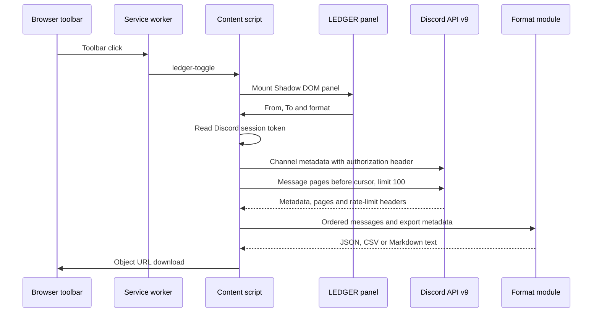

# Discord History Exporter Architecture

Discord History Exporter is a Manifest V3 Chromium extension made from plain JavaScript modules. The browser loads the shipped source directly. There is no server, build output or runtime package graph.

## Component Boundaries

| Component | Responsibility | Source |
|:--|:--|:--|
| Extension manifest | Declares the service worker, Discord content script, icons, host scope and web-accessible modules | `extension/manifest.json` |
| Service worker | Sends `ledger-toggle` to the active tab when the toolbar button is pressed | `extension/src/background.js` |
| Content script | Mounts and removes the panel, reads the token, coordinates exports and creates browser downloads | `extension/src/content.js` |
| Panel and calendar | Render the isolated interface, collect the range and format, report state and contain input events | `extension/src/panel.js`, `extension/src/calendar.js` |
| Route and time modules | Parse Discord channel paths and translate local times into half-open snowflake bounds | `extension/src/channel.js`, `extension/src/time.js` |
| API exporter | Retrieves metadata and message pages, applies pacing and bounded retries, validates replies and handles cancellation | `extension/src/api.js` |
| Format modules | Produce the JSON envelope, RFC 4180 CSV and readable Markdown transcript | `extension/src/formats/` |

## Runtime Flow



The panel also opens when a Discord URL contains the `ledger` query parameter. `extension/src/content.js` installs the query check after the content-script input guard.

## Extension Lifecycle

`extension/manifest.json` matches `*://discord.com/*` and loads `extension/src/content.js` at `document_idle`. The content script is deliberately non-modular because Chromium content scripts cannot use a module declaration in the manifest. Dynamic imports load web-accessible modules through `chrome.runtime.getURL()`.

The toolbar action runs through the service worker in `extension/src/background.js`. A Discord tab that was open before installation or extension reload has no revised content script, so the toggle message is dropped until the tab is reloaded. The rejected send is deliberately swallowed because there is no receiver in that tab.

Only one panel can mount at a time. The `mounting` promise in `extension/src/content.js` ignores another toggle while imports and setup are in progress. A later toggle removes the panel and cancels any active exporter.

## Interface Isolation

`mountPanel()` in `extension/src/panel.js` creates the interface inside an open Shadow DOM root. The `:host { all: initial; }` rule resets inherited page styling, and keyboard, mouse and wheel events from the panel stop bubbling at the shadow root.

Discord's page moves keystrokes typed outside its own fields into its message box. `installInputGuard()` in `extension/src/content.js` intercepts keyboard, input and wheel events whose composed path includes the panel host, at `window` in the capture phase. Panel key handling runs before propagation stops. This keeps date and format controls usable without sending their keystrokes into Discord's message box.

The panel defaults to the previous 24 hours, exposes second-level `datetime-local` inputs, supplies one month-grid calendar for either date field and offers JSON, CSV and Markdown. The About card flips into the same grid cell, makes the hidden face inert and keeps an active export running.

## Channel Resolution

`parseChannel()` in `extension/src/channel.js` accepts paths with these shapes:

- `/channels/{guild}/{channel}`
- `/channels/{guild}/{channel}/{message}`
- `/channels/@me/{channel}`
- `/channels/@me/{channel}/{message}`

Guild, channel and optional message identifiers must be unsigned decimal snowflakes of at most 20 digits. A message link therefore resolves to its containing channel. Threads, forum posts and group direct messages work because Discord places their channel identifier in the same route position.

Discord changes channels without reloading the page. While the panel is open and no export is running, `mount()` in `extension/src/content.js` rechecks the address every 500 milliseconds and updates the channel line; during an export the line keeps naming the channel being read. `runExport()` parses the address again when **Export** is pressed.

## Time Range Algorithm

Discord snowflakes contain a millisecond timestamp above 22 lower identifier bits. `msToSnowflake()` in `extension/src/time.js` converts a millisecond to the lowest possible snowflake at that instant.

`rangeBounds()` interprets both inputs as wall-clock time in the browser machine's timezone. The start is inclusive. The end becomes the first snowflake at the start of the second after the selected To value, producing `[startId, beforeId)`. The complete To second is included without overlapping the next second. Exports record the machine's IANA timezone so the local timestamps remain interpretable.

## Message Walk

`createExporter().run()` in `extension/src/api.js` walks backwards through `GET /channels/{channelId}/messages` with an exclusive `before` cursor and `limit=100`.

Each successful body must be an array whose messages have numeric IDs. The oldest ID is found by comparison rather than by trusting response order. A page that fails to move the cursor backwards aborts the export. Messages outside the requested half-open range are discarded, the collected result is sorted oldest first and repeated IDs are removed.

The walk stops when:

- Discord returns an empty page;
- the oldest message in a page reaches or passes the range floor;
- cancellation aborts the active request or wait;
- five consecutive transient failures occur;
- ten consecutive rate limits occur; or
- the 5,000-page ceiling is reached.

No partial export is saved after failure or cancellation. `runExport()` in `extension/src/content.js` calls a format module only after the complete walk returns a non-empty message array.

## Pacing and Failure Handling

Ordinary page transitions wait 400 milliseconds plus zero to 199 milliseconds of jitter. When Discord reports an exhausted bucket through `x-ratelimit-remaining: 0`, the announced `x-ratelimit-reset-after` value replaces the ordinary delay and is capped at 60 seconds.

HTTP 429 retries the same cursor after `retry_after` from the body or `Retry-After` from the headers. The fallback is five seconds and every rate-limit wait is at least one second. Ten consecutive rate limits stop the run.

HTTP 401, 403, 404 and every other client error except 408 and 429 stop after one request. HTTP 408, server errors, network errors, timeouts, invalid JSON and malformed successful bodies retry the same request after one, two, four and eight seconds. The fifth consecutive transient failure stops the run. A successful request resets the transient-failure sequence.

Every request has a 30-second timeout. The export's shared abort signal cancels in-flight requests, pacing and rate-limit waits.

## Metadata and Naming

Before the message walk, the exporter requests channel metadata. A direct message uses its recipient usernames when no channel name exists. A guild-name lookup labels the output but does not control message access; failure falls back to `Unknown server`.

Export filenames follow `Ledger_<channel-slug>_<from-stamp>_<to-stamp>.<format>`. The slug contains lower-case ASCII letters, digits and hyphens. Empty slugs fall back to the channel ID. Time stamps use machine-local `YYYYMMDD-HHMM` values.

## Output Structures

### JSON

`renderJsonExport()` in `extension/src/formats/json.js` wraps unchanged Discord message objects in an envelope containing `tool: "ledger"`, extension version, UTC export time, source metadata, local range metadata, timezone and message count. Raw objects can contain more fields than the other formats expose.

### CSV

`renderCsvExport()` in `extension/src/formats/csv.js` writes a UTF-8 byte order mark and CRLF-terminated RFC 4180 rows with nine fixed columns. Quotes, commas and line breaks are escaped. Text beginning with optional whitespace or control characters followed by `=`, `+`, `-` or `@` receives an apostrophe prefix to reduce spreadsheet formula execution.

### Markdown

`renderMarkdownExport()` in `extension/src/formats/md.js` writes source and range metadata followed by one chronological record per message. Attachment URLs, textual embed parts and reply identifiers appear under the message. Replies name the referenced author only when that message is present in the same export.

## Download Path and Retention

`saveFile()` in `extension/src/content.js` creates a text `Blob`, clicks a temporary anchor with a download filename and revokes the object URL four seconds later. The extension requests no downloads permission. The browser decides the final download location and retains the file under the browser and operating system's rules.

The session token and collected message array live only in the running tab's memory. The code writes neither to extension storage nor to a server. Closing the panel cancels the active exporter and removes the panel host.

## Design Decisions

| Decision | Reason | Rejected alternative |
|:--|:--|:--|
| Unpacked plain modules | The browser can load the source directly and runtime dependencies remain zero | A bundler would add generated output and a dependency chain without changing the extension's small module graph |
| The logged-in session, read at export start | Every channel the account can see, direct messages included, with no setup; the token's lifetime is Discord's own | A bot token is a narrower credential but cannot read direct messages and needs an application, an invitation and permissions per server; persisting the user token would add a credential store |
| Backwards pagination with snowflake bounds | Discord's exclusive `before` cursor maps directly to an exact half-open time range | Filtering only after an unbounded full-history download would fetch unrelated history |
| Full-run completion before formatting | A saved filename must describe a complete range | Streaming partial files would require resumable state and a format-specific incomplete marker |
| Object URL download | The browser saves the finished text without a downloads permission | `chrome.downloads` would add the `downloads` permission for the same result |
| Shadow DOM with a capture guard | Discord styles and global input handlers must not control the exporter interface | Rendering directly in the page would share CSS and event behaviour with Discord |
| Bounded retries and page ceiling | A failed or non-moving request must end predictably | Unlimited retries or pagination could run indefinitely and disguise a truncated result |

## Verification

Run the unit suites from the repository root:

```bash
node --test
```

The suites cover time and snowflake arithmetic, route parsing, pagination, response classification, rate limits, cancellation, timeouts, output fidelity and CSV formula guards.

The suites run 51 unit tests.

Run the routed-fake Chromium gate where Playwright and Chromium are available:

```bash
LEDGER_BROWSER_TOOLS=/path/to/playwright-project \
LEDGER_CHROMIUM=/path/to/chromium \
node tests/browser_gate.mjs
```

`tests/browser_gate.mjs` intercepts every `discord.com` request and serves fixtures, so the gate does not contact live Discord. It exercises the loaded extension, panel controls, service worker, downloads, format content, channel routes, refusal handling and in-flight cancellation.

The browser gate runs 44 checks.

---

<div align="center">
<br>

**_Architected by Nauman Shahid_**

<br>

[](https://www.nauman.cc)
[](https://github.com/nshah1d)
[](https://www.linkedin.com/in/nshah1d/)

</div>
<br>

Licensed under the [MIT Licence](../LICENSE).
